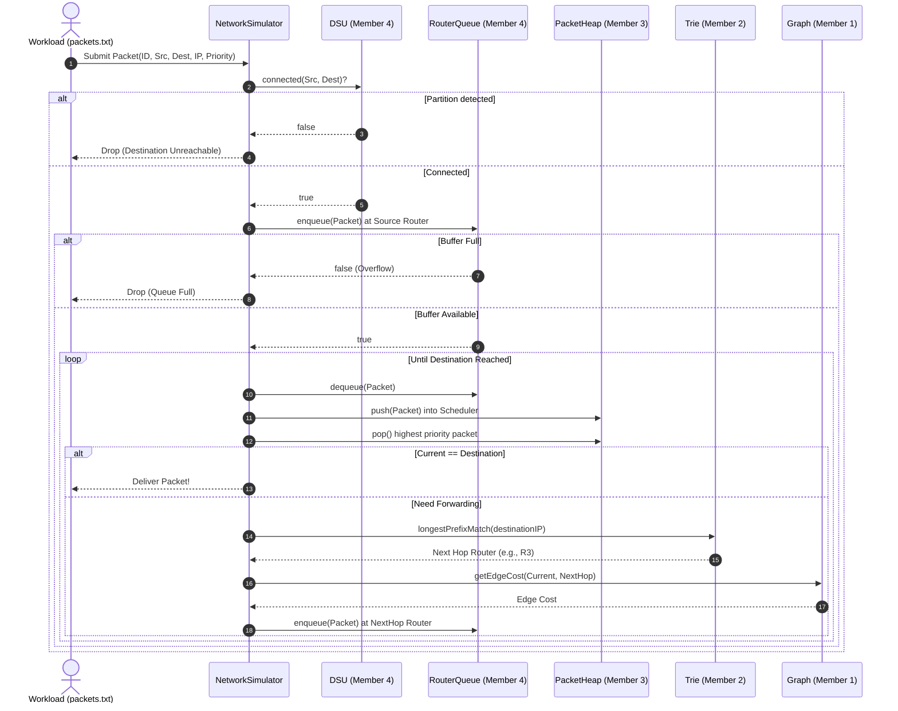

# Internet Packet Routing Simulator — Integration Architecture

This document describes the unified system architecture, module coordination, data flow, and runtime mechanics for the integrated Internet Packet Routing Simulator.

---

## 1. High-Level Architecture Overview

The simulator models a carrier-grade packet-switched network where packets travel hop-by-hop between routers according to destination IPv4 prefixes, shortest paths, quality-of-service priority, and bounded memory buffers.

```
                           +---------------------------+
                           |  NetworkGraph (Member 1)  |
                           |   Dijkstra Shortest Path  |
                           +-------------+-------------+
                                         |
                                         | 1. Shortest Paths & Next Hops
                                         v
+--------------------------+       +-----+---------------------+       +---------------------------+
|   DSU (Member 4)         |       |    Trie (Member 2)        |       |  RouterQueue (Member 4)   |
|   Topology Connectivity  |       | Longest Prefix Match      |       |  Bounded Ingress Buffer   |
|   & Partition Detection  |       | Forwarding Tables         |       |  (FIFO Hardware Memory)   |
+--------------------------+       +-------------+-------------+       +-------------+-------------+
                                                 |                                   |
                                                 | 3. Next Hop Lookup                | 2. Packet Buffer
                                                 v                                   v
                                    +------------+-----------------------------------+-------------+
                                    |                NetworkSimulator (Integration Layer)          |
                                    +------------------------------+-------------------------------+
                                                                   |
                                                                   | 4. Priority Scheduling
                                                                   v
                                                   +---------------+---------------+
                                                   |    PacketHeap (Member 3)      |
                                                   |    Priority Max-Heap          |
                                                   +-------------------------------+
```

---

## 2. Directory & Module Structure

```
├── common.h                           # Shared data contracts (Packet, RouteResult, PacketResult)
├── input.txt                          # Network graph topology (router count, links, costs)
├── routing_config.txt                 # Destination IP subnet mapping (router -> IP/prefix)
├── packets.txt                        # Input packet workload (ID, src, dest, IP, priority)
├── Makefile                           # Automated build and test harness
├── main.cpp                           # Simulator CLI entry point
├── demo.cpp                           # Interactive multi-scenario demonstration
├── INTEGRATION.md                     # Integration architecture documentation
├── integration/
│   ├── network_simulator.h            # Simulator orchestration engine header
│   └── network_simulator.cpp          # Integration logic, routing loops, failure recovery
├── Dijkstra/                          # Member 1
│   ├── dijkstra.h                     # Graph and Dijkstra shortest path declarations
│   ├── dijkstra.cpp                   # Adjacency list, priority_queue Dijkstra implementation
│   └── test_dijkstra.cpp              # Member 1 standalone unit tests
├── Member2_Trie/                      # Member 2
│   ├── trie.h                         # 32-bit binary trie declarations
│   ├── trie.cpp                       # IPv4 bit conversion & Longest Prefix Match
│   └── README.md                      # Member 2 specification
├── Member3_PacketHeap/                # Member 3
│   ├── packet_heap.h                  # Binary max-heap scheduler declarations
│   ├── packet_heap.cpp                # Priority sift-up/sift-down and tie-breaking
│   └── README.md                      # Member 3 specification
├── Member4_RouterQueue_DSU/           # Member 4
│   ├── router_queue.h                 # Bounded circular queue declarations
│   ├── router_queue.cpp               # Fixed-size buffer with modulo index wraparound
│   ├── dsu.h                          # Disjoint Set Union declarations
│   ├── dsu.cpp                        # Path compression and union-by-rank
│   ├── test_member4.cpp               # Member 4 standalone unit tests
│   └── README.md                      # Member 4 specification
└── tests/
    ├── test_integration.cpp           # Automated end-to-end integration test suite
    └── README.md                      # Test suite documentation
```

---

## 3. The 4 Core Modules & Why They Are Used

### Module 1: Graph & Dijkstra (Member 1)
* **Problem Solved**: Finds the mathematically shortest path across the network topology based on link costs.
* **Role in Integration**: Runs once during initialization (and upon simulated link failures) to compute the global shortest paths between every pair of routers.
* **Key Function**: `graph.shortestPath(source, destination)` and `graph.getNextHop(source, destination)`.

### Module 2: Binary Trie & Forwarding (Member 2)
* **Problem Solved**: Resolves 32-bit destination IPv4 addresses to the immediate next hop router in $O(32) = O(1)$ constant time.
* **Role in Integration**: Each router has its own `Trie`. Dijkstra's computed next hops are populated into the Tries for destination IP prefixes. When a packet arrives, the router queries its Trie using **Longest Prefix Matching (LPM)**.
* **Key Function**: `routingTables[router].longestPrefixMatch(destinationIP)`.

### Module 3: Priority Max-Heap Scheduler (Member 3)
* **Problem Solved**: Resolves resource contention when multiple packets compete for transmission at the same router.
* **Role in Integration**: Packets with higher priority numbers (e.g. VoIP, urgent alarms) are processed before lower-priority packets (e.g. background file transfers). If priorities are equal, lower packet IDs are processed first (deterministic tie-breaking).
* **Key Function**: `heap.push(packet)` and `heap.pop()`.

### Module 4: Bounded Circular Queue & DSU (Member 4)
* **RouterQueue (Buffering)**: Models finite router hardware RAM. If a router's buffer is full, incoming packets are dropped due to congestion.
* **DSU (Connectivity)**: Uses union-find with path compression and rank to instantly determine if two routers belong to the same connected component. Quickly detects network partitions before wasting network hops.
* **Key Functions**: `queue.enqueue(packet)`, `queue.dequeue(packet)`, and `dsu.connected(u, v)`.

---

## 4. End-to-End Packet Lifecycle



---

## 5. Building and Running

A unified `Makefile` is provided for zero-friction building and testing.

### Compile Everything
```bash
make all
```
This produces two executables: `simulator` and `demo`.

### Run the CLI Simulator
```bash
./simulator
```
Or with custom data files:
```bash
./simulator input.txt routing_config.txt packets.txt
```

### Run the Interactive Demo
```bash
./demo
```
The demo walks through 5 complete real-world scenarios:
1. **Standard End-to-End Delivery**: Traces packet $R1 \to R16$ with costs.
2. **Priority Preemption**: High priority packets jumping ahead of low priority packets in the queue.
3. **Queue Overflow Drop**: Enforcing router buffer capacity and verifying congestion drops.
4. **Dynamic Link Failure & Rerouting**: Simulating a severed fiber cable ($R8-R16$), recomputing shortest paths, updating Tries, and rerouting packets.
5. **Network Partition Detection**: Detecting isolated routers instantly using DSU.

### Run Integration Tests
```bash
make test
```
Executes all 8 integration tests covering unit interfaces, contracts, edge cases, buffer limits, and dynamic rerouting.

### Clean Build Artifacts
```bash
make clean
```
